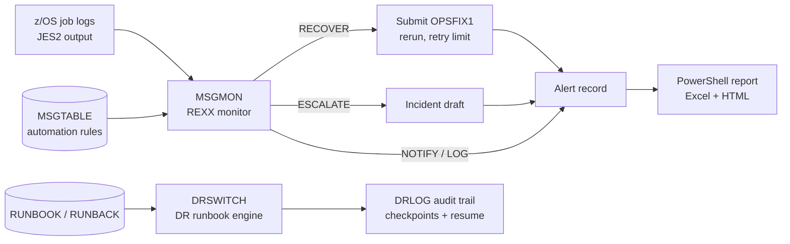

<div align="center">

# 🍁 Maple Ops Automation Lab

**A mainframe automation toolkit in REXX on real IBM z/OS: table-driven message monitoring, automatic recovery and a GDPS-style DR runbook engine**

[](https://github.com/jamierowe15/maple-ops-automation-lab/actions/workflows/ci.yml)
[](#-results)
[](#-repository-layout)
[](tests/run-tests.sh)
[](LICENSE)

### [📊 Live alert report](https://jamierowe15.github.io/maple-ops-automation-lab/) · [📘 Lab guide](LAB-GUIDE.md) · [📐 Standards](STANDARDS.md) · [🧾 DR audit trail](evidence/DRLOG.txt)

</div>

---

A small mainframe automation toolkit written in **REXX on IBM z/OS** (IBM Z Xplore). At lab scale, it does the work of a mainframe automation team: watching job output for problems, fixing the ones it knows how to fix, escalating the rest, and running a disaster-recovery site switch step by step.

> **Honesty note.** GDPS, NetView and System Automation for z/OS are licensed IBM products that aren't available in a free sandbox. This lab is **modelled on** how they work, using standard z/OS features (REXX, TSO, JES2, JCL). The z/OS parts run on a real IBM z/OS system through IBM Z Xplore.

## 📑 Contents
- [What it does](#-what-it-does)
- [How it works](#-how-it-works)
- [Quick start](#-quick-start)
- [Repository layout](#-repository-layout)
- [Results](#-results)
- [Related labs](#-related-labs)

## 🛠 What it does

| Team function | What this lab does |
|---|---|
| Message and system alerting | `MSGMON` scans job logs for message IDs (`IEF212I`, `IEF450I`, `CEE3207S` ...) and condition codes, and writes one alert per hit |
| Operational automation | Rules live in a **table** (`MSGTABLE`), not in code, the same way NetView / System Automation automation tables work. A `RECOVER` rule submits a recovery job, with a retry limit so a broken job can't loop forever |
| GDPS DR scripting and testing | `DRSWITCH` runs an ordered site-switch runbook (checks → stop work → switch disk mirror → move active site → restart → verify), with dry run, fault-injection drills, checkpoints and resume |
| Monitoring and reporting | A PowerShell step turns the alerts into an Excel/HTML report and drafts incident records for escalations |
| Coding standards | [STANDARDS.md](STANDARDS.md): headers, return codes 0/4/8/12, table-driven design, dry-run first |

It links to the **[Maple Host Release Lab](https://github.com/jamierowe15/maple-host-release-lab)**: the monitor watches that lab's production batch run (`MPSTREAM`) and classifies it with the same rules table.

## 🧭 How it works



## 🚀 Quick start

Double-click **`RUN-MAPLE-LABS.cmd`** on Windows. Its menu creates this repo, runs an offline rehearsal, runs everything on Z Xplore through Zowe CLI, builds the report and publishes to GitHub.

Doing it by hand instead? Follow **[LAB-GUIDE.md](LAB-GUIDE.md)**.

## 📂 Repository layout

```
src/rexx     MSGMON (message monitor), DRSWITCH (DR runbook engine)
src/jcl      OPSALLOC, test jobs OPSJOB1-5, recovery OPSFIX1, run jobs
src/cntl     MSGTABLE (automation rules), RUNBOOK / RUNBACK (DR scripts)
samples      a sample job log for offline rehearsal and tests
tests        30 regression tests (Regina REXX), run by GitHub Actions
evidence     job logs, reports and screenshots from the real runs
```

## 📊 Results

*Run on IBM Z Xplore, 2026-11-23.*

**Message monitor (live run)**

| Job | Problem | Action taken | Outcome |
|---|---|---|---|
| OPSJOB1 | `IEFA107I` data set not found | RECOVER | ✅ Recovered automatically on try 1 of 2: OPSFIX1 CC 0000, rerun CC 0000, second pass CLEAN |
| OPSJOB2 | CC 8 | ESCALATE | Incident drafted |
| OPSJOB3 | S806 abend | ESCALATE | Incident drafted |
| OPSJOB4 | none | LOG | Logged clean |
| OPSJOB5 | CC 4 | NOTIFY | Notification raised |

**DR drill**

| Step | Outcome |
|---|---|
| Fault injected at step 7 | ✅ Run halted safely (CC 0008) |
| New run attempted while incomplete | ✅ Refused (CC 0008) |
| `RESUME` from checkpoint | ✅ Completed (CC 0000) |
| Switch-back (`RUNBACK`) | ✅ CC 0000 |

**Evidence:** job logs in [`evidence/joblogs`](evidence/joblogs), the alert report in [`evidence/reports`](evidence/reports) ([live view](https://jamierowe15.github.io/maple-ops-automation-lab/)), and the DR audit trail in [`evidence/DRLOG.txt`](evidence/DRLOG.txt).

## 🔗 Related labs

| Lab | Focus |
|---|---|
| [Maple Host Release Lab](https://github.com/jamierowe15/maple-host-release-lab) | COBOL release on z/OS: PAT, CAB, emergency change, restart, PIR, SOX controls |
| [Fort Charles PAM Lab](https://github.com/jamierowe15/fort-charles-pam-lab) | PowerShell privileged access management lab modelled on CyberArk PAS |

---

<div align="center">

**Jamie Rowe** · [github.com/jamierowe15](https://github.com/jamierowe15) · Toronto, ON

*Maple is fictional. GDPS, NetView and System Automation are IBM trademarks and are modelled, not used.*

</div>
